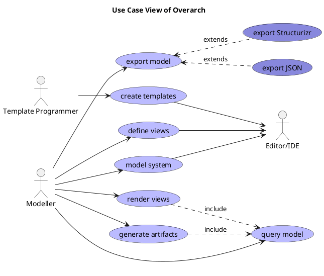

# query model (Use-case)
## Description
Query the model with selection criteria.

## Actors
| Actor | Description |
|---|---|
| [Modeller](../../overarch/roles/modeller.md) | Models the architecture of a system and specifies views of the model. |
## Including Use Cases
| Use Case | Description |
|---|---|
| [generate artifacts ](../../overarch/use-case/generate-artifacts.md) | Generate artifacts with templates from model selections. |
| [render views](../../overarch/use-case/render-views.md) | Render the views of the system. |

## Use Case View

[Use Case View of Overarch](../../overarch/use-case/use-case-view.md)

## Navigation
[List of views in namespace](./views-in-namespace.md)

[List of all Views](../../views.md)

(generated by [Overarch](https://github.com/soulspace-org/overarch) with template docs/node.md.cmb)
